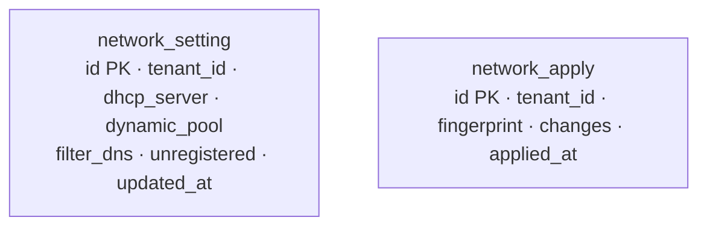

# network_manager — Database Diagram

- Una fila `network_setting` por inquilino (`SaveSetting` la reemplaza). `unregistered`: `no_address` / `local`.
- `network_apply` es historial de solo añadir: una fila por aplicación exitosa, la más nueva primero.
- Las filas de plan, de conexiones y descubiertas nunca se almacenan: se computan desde la puerta de enlace.
